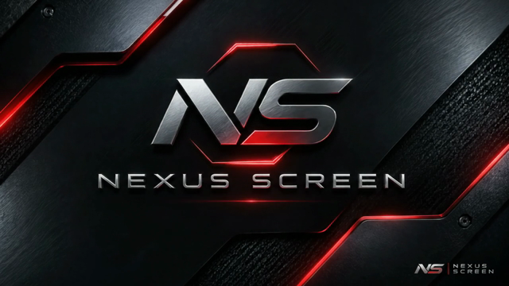
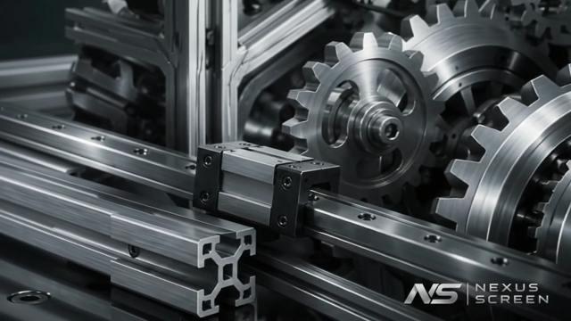
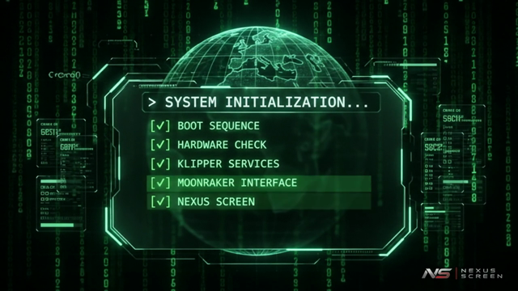
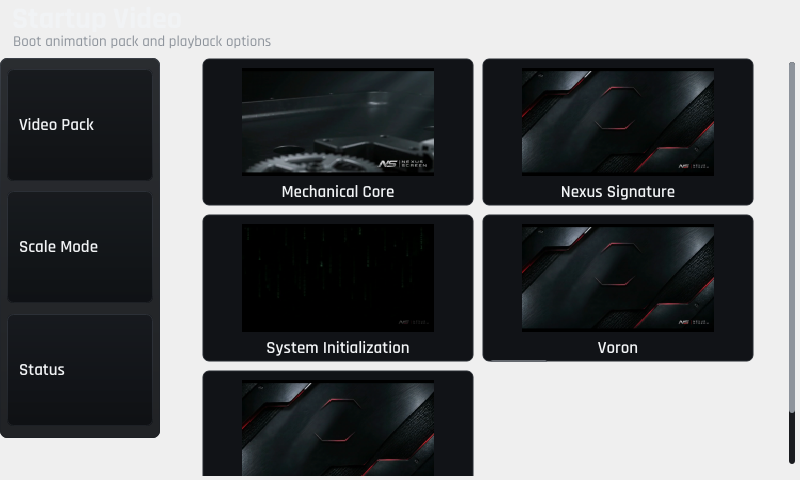

# Nexus Video

> Cinematic boot splash add-on for [Nexus Screen](https://github.com/TheOmProject/Nexus-Screen).

Nexus Video is an **optional add-on** for Nexus Screen. It replaces the default static splash
with animated startup video packs. It plays a 10-second intro once at boot, then loops ambient
video while the printer connects — with no desktop environment required.

**Status: Public Beta — v0.1.0-beta.1**  
Requires [Nexus Screen](https://github.com/TheOmProject/Nexus-Screen) v0.2.0-beta.5 or later.

---

## Preview Gallery

### Built-in Packs

| Nexus Signature | Mechanical Core | System Init |
|:---:|:---:|:---:|
|  |  |  |
| *Clean white-on-black grid reveal* | *Cinematic CoreXY macro shots* | *Green-on-black terminal sequence* |

### Startup Video Selector in Nexus Screen

The **Settings → Startup Video** screen (added to Nexus Screen via the included integration patch) lets
you browse, preview, and switch packs without touching the terminal.



---

## Features

- **Optional add-on for Nexus Screen** — installs alongside Nexus Screen without modifying it
- **Three built-in packs** — Nexus Signature, Mechanical Core, System Initialization
- **Custom packs** — drop in your own `intro.mp4` and `loop.mp4`
- **Adaptive display scaling** — auto-detects framebuffer resolution and pixel format
- **Fit / Fill / Stretch** — choose how video fills your display per pack
- **Minimum resolution: 480×320** — all verified touch-accessible at this size; 800×480 is the reference
- **Multi-format framebuffer** — supports RGB565 (16bpp) and BGRA/RGBA/ARGB/ABGR (32bpp)
- **Preserves custom packs and preferences** on update
- **Handover protocol compatible** with Nexus Sounds (startup chime timing unchanged)

---

## Minimum Requirements

| Requirement | Minimum |
|---|---|
| **Nexus Screen** | v0.2.0-beta.5 or later (must be installed first) |
| **SBC** | Raspberry Pi 4 or BigTreeTech CB1, 64-bit (aarch64) |
| **OS** | Debian 12 (Bookworm) or Raspberry Pi OS (Bookworm), 64-bit |
| **RAM** | 1 GB (2 GB recommended) |
| **Free disk** | 500 MB in home directory |
| **Display** | Physical framebuffer at `/dev/fb0`, minimum **480×320** |
| **Pixel format** | RGB565 (16bpp) or BGRA/RGBA/ARGB/ABGR (32bpp) |
| **Python** | 3.9+ (Python 3.11 included with Bookworm) |
| **FFmpeg** | Any recent version — `sudo apt install ffmpeg` |

---

## Installation

**Via Nexus Screen bootstrap (recommended — installs Nexus Screen and Nexus Video together):**
```bash
curl -fsSL https://raw.githubusercontent.com/TheOmProject/Nexus-Screen/main/deploy/bootstrap.sh | bash -s -- --with-video
```

**Standalone — add to an existing Nexus Screen installation:**
```bash
# 1. Clone the repository
git clone https://github.com/TheOmProject/Nexus-Video.git ~/nexus-video

# 2. Run the hardware preflight check (no changes made)
bash ~/nexus-video/deploy/preflight.sh

# 3. Install (requires sudo)
sudo bash ~/nexus-video/deploy/public-install.sh
```

The installer:
1. Runs a hardware preflight check; stops with "INSTALLATION BLOCKED" if requirements are not met — no system changes are made.
2. Converts the built-in video packs from source MP4s (requires FFmpeg).
3. Configures and enables `nexus-video.service`.
4. Disables `nexus-splash.service` (Nexus Screen's built-in static splash) — changes take effect at next boot.

**On update**, your `config.json` (pack selection) and `packs/custom/` (custom packs) are preserved.

> **Note:** `install.sh` in the same directory is the development installer and requires
> pre-built artifacts. Use `public-install.sh` for the standard user workflow.

---

## Updating

### Via Moonraker Update Manager (recommended)

Add the following to your `moonraker.conf`, then restart Moonraker:

```ini
[update_manager nexus-video]
type: git_repo
path: ~/nexus-video
origin: https://github.com/TheOmProject/Nexus-Video.git
primary_branch: main
is_system_service: False
managed_services: nexus-video
```

See [`deploy/moonraker-update-manager.conf`](deploy/moonraker-update-manager.conf) for the full snippet.

### Manual update

```bash
cd ~/nexus-video
git pull
bash deploy/install.sh
```

---

## Uninstalling

```bash
bash ~/nexus-video/deploy/uninstall.sh
```

Uninstalling re-enables `nexus-splash.service` and removes `nexus-video.service`.
Your `packs/custom/` files are not deleted.

---

## Custom Video Packs

See **[CUSTOM_VIDEOS.md](CUSTOM_VIDEOS.md)** for a step-by-step guide on creating,
validating, and importing your own packs.

Quick summary:

```bash
# Validate a custom pack
python3 nexus_video_cli.py validate --pack my_pack

# Convert to your display's resolution
python3 nexus_video_cli.py convert --pack my_pack --scale-mode fit
```

Custom packs live in `packs/custom/` and are never modified by updates.

---

## Nexus Screen Integration

The **Settings → Startup Video** screen is included in Nexus Screen v0.2.0-beta.5 and later.
No manual patch is needed when installing via the bootstrap script or when Nexus Screen is
already at v0.2.0-beta.5.

If your Nexus Screen installation predates v0.2.0-beta.5, update it first:
```bash
cd ~/nexus-screen && git pull
sudo systemctl restart nexus-screen
```

---

## Hardware Compatibility

Nexus Video requires Nexus Screen to be installed first. The table below shows Nexus Video status independently.

| Hardware | NV FFmpeg Conversion | NV Service / Playback | Notes |
|---|---|---|---|
| Raspberry Pi 4 (2 GB), 800×480 RGB565, Debian 12 | **ISOLATED EXECUTION** | NOT TESTED | Conversion verified on this machine; framebuffer playback not tested |
| Raspberry Pi 4 (4 GB), Voron 2.4, 800×480 BGRA8888 | NOT TESTED | NOT TESTED | NS physically verified; NV not installed there |
| BigTreeTech CB1, 480×320 RGB565 | NOT TESTED | NOT TESTED | NS physically verified; NV not tested |
| Raspberry Pi 3, Pi 5, Pi Zero 2 W | NOT TESTED | NOT TESTED | Community reports welcome |
| Debian 11 Bullseye | NOT SUPPORTED | NOT SUPPORTED | Installer blocks |

**ISOLATED EXECUTION** = component tested in isolation (conversion, CLI) without full service installation.
**NOT TESTED** = unknown; community reports welcome.

Nexus Video framebuffer playback has not been physically verified end-to-end on any device.
Installation and service configuration have not been run as a complete clean install on any device.
This is a release candidate — contributions and hardware reports are welcome.

---

## Bug Reports

[Open a Bug Report](https://github.com/TheOmProject/Nexus-Video/issues/new?template=bug_report.yml)

Before filing: collect logs with:
```bash
journalctl -u nexus-video -b --no-pager -n 50
systemctl status nexus-video
bash ~/nexus-video/deploy/preflight.sh
```

---

## Troubleshooting

```bash
# Check service status
systemctl status nexus-video

# View recent logs
journalctl -u nexus-video -b --no-pager | tail -40

# Re-run hardware preflight
bash ~/nexus-video/deploy/preflight.sh
```

**Common issues:**

| Symptom | Cause | Fix |
|---|---|---|
| Black screen at boot | Pack not built | Run `convert --pack nexus_signature` |
| "INSTALLATION BLOCKED" | Hardware requirement not met | Read preflight output and fix the listed failures |
| Service fails to start | Missing FFmpeg | `sudo apt install ffmpeg` |
| still frame wrong size | Display resolution differs from build | A companion `still.png` is used automatically as fallback |
| No splash at all | Service not enabled | `sudo systemctl enable --now nexus-video` |

---

## License

Nexus Video is released under the [GNU General Public License v3.0](LICENSE).

---

## Related

- **[Nexus Screen](https://github.com/TheOmProject/Nexus-Screen)** — the touchscreen UI Nexus Video extends (required; install first)
